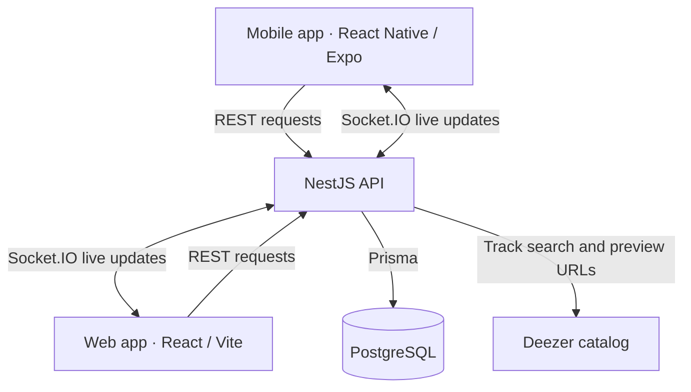

# Sonora · Music Room

A collaborative music application for discovering tracks, building shared playlists, and letting a group choose what plays next. Sonora brings a mobile app and a web client together around one API, with live updates across connected users.

Built as a 42 Music Room project, this repository covers the product from database and authentication to mobile interfaces, browser interactions, and real-time collaboration.

## The experience

Imagine a gathering where everyone can suggest music and vote on the next track. The host manages the room, participants follow a live queue, and changes appear across connected clients. Outside a room, users can create collaborative playlists, find friends with similar music tastes, and share control of their registered devices.

- **Music rooms:** create public or private rooms, invite participants, suggest tracks, and vote on the queue. Rooms can include a location, schedule, and voting restrictions.
- **Collaborative playlists:** search for tracks, add and reorder them, and manage visibility, editing permissions, and invitations.
- **Profiles and friends:** customize profiles, discover people by name or music genre, and manage friend requests. Profile sections support public, friends-only, and private visibility.
- **Accounts:** email verification, password recovery, Google sign-in, and mobile Facebook sign-in, with explicit social-account linking.
- **Devices and playback:** register devices, grant friends control, and receive remote playlist playback commands while the target app is connected.
- **Nearby discovery:** the mobile implementation uses opt-in geofencing to notify users when they approach eligible public rooms.

Music search and playback use the **Deezer catalog and short previews**, rather than full-track streaming.

## Explore the repository

Each component has its own README with setup instructions and implementation details.

| Component | Purpose | Documentation |
| --- | --- | --- |
| `music-room-api` | Authentication, profiles, friendships, rooms, playlists, device permissions, catalog integration, and real-time events | [API README](music-room-api/README.md) |
| `music-room-mobile` | React Native / Expo application for Android and iOS | [Mobile README](music-room-mobile/README.md) |
| `music-room-web` | Responsive React application built with Vite | [Web README](music-room-web/README.md) |
| `music-room-iot` | Explanation of the nearby-room geofencing approach, privacy choices, limitations, and demo steps | [Nearby discovery / IoT README](music-room-iot/README.md) |
| `sonora-legal` | Standalone static privacy and data-deletion information pages | [Legal pages README](sonora-legal/README.md) |

## How it fits together



The API owns business rules and permissions. Clients submit actions through REST and receive shared room and playlist state through Socket.IO. PostgreSQL stores application data, while Prisma manages database access and migrations.

| Area | Technologies |
| --- | --- |
| Language | TypeScript |
| Backend | NestJS, Prisma, PostgreSQL |
| Mobile | React Native, Expo, SecureStore |
| Web | React, Vite, React Router |
| Live communication | Socket.IO |
| Local backend environment | Docker Compose, Make |
| Validation and automation | Jest, Node.js test runner, TypeScript checks, GitHub Actions |

## Engineering highlights

For a technical review, these are useful starting points:

- **Concurrent collaboration:** database constraints, transactions, row locks, and version checks protect votes, playlist ordering, and room playback from conflicting updates. See [music architecture decisions](music-room-api/docs/TECH-CHOICES-MUSIC.md).
- **Session lifecycle:** rotating refresh tokens, device-associated sessions, logout and revocation, plus client handling for concurrent refresh requests. See [authentication and users](music-room-api/docs/AUTH-USERS.md).
- **Authorization beyond the interface:** the API checks private-room access, playlist editing permissions, profile visibility, and delegated device control. See [authentication security](music-room-api/docs/SECURITY-AUTH.md) and [music security](music-room-api/docs/SECURITY-MUSIC.md).
- **Live state synchronization:** shared snapshots keep room queues and playlists aligned, with access checks and subscription limits. The protocol is documented in the [API README](music-room-api/README.md#real-time-websocket).
- **Automated verification:** backend unit and integration tests, mobile and web client regression tests, and backend/mobile CI workflows. See [backend CI](music-room-api/docs/CI.md), [backend workflow](.github/workflows/backend-ci.yml), and [mobile workflow](.github/workflows/mobile-ci.yml).
- **Performance investigation:** documented load-testing methodology and measurements are available in the [load-testing report](music-room-api/docs/RAMP-UP.md).

Additional rationale is available in the [backend technical choices](music-room-api/docs/TECH-CHOICES.md), and endpoint documentation in the [API guide](music-room-api/docs/API.md).

## Run locally

Start with the backend, then run either client. Follow the component READMEs for runtime versions, environment variables, and provider configuration.

**Backend** — requires Docker running and Make:

```sh
cd music-room-api
make
```

The API exposes interactive Swagger documentation at `http://localhost:3000/docs`. The [backend README](music-room-api/README.md#configuration) explains the generated local configuration, JWT secrets, and Google authentication settings required before startup.

**Web** — in a separate terminal, from the repository root:

```sh
cd music-room-web
npm ci
cp .env.example .env
npm run dev
```

Open `http://localhost:5173`. See the [web setup](music-room-web/README.md#run-locally) for API and Google sign-in configuration.

**Mobile** — use the [mobile setup guide](music-room-mobile/README.md#start-the-app) for Expo, simulator or physical-device networking, and native development builds. Google and Facebook native integrations require platform-specific configuration.

## Project status and scope

Sonora is a development and portfolio project. Automated checks and documented manual checks cover different parts of the system; they do not imply that every feature has been accepted on every target device. The mobile README records the scope of platform testing.

Playback is limited to catalog previews and connected target devices. Nearby alerts use GPS geofencing, with its accuracy and permission constraints; there is no physical Bluetooth beacon integration. Offline music playback is not implemented. The Free/Premium switch is a demonstration of API-enforced playlist limits, without a payment integration. Legal pages and in-app legal text remain drafts to finalize before a public release.
